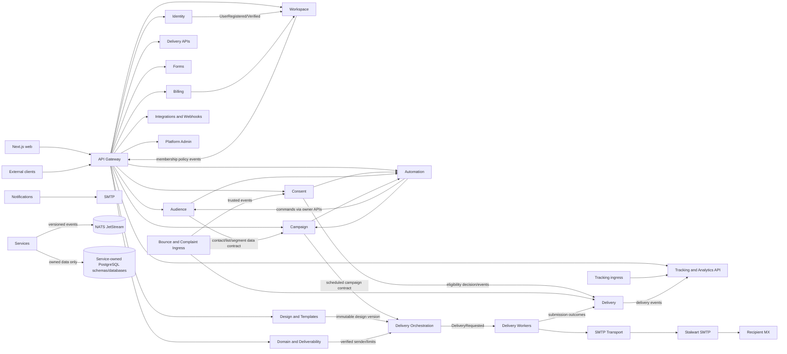

# Service Dependency Graph

This graph is the intended dependency order, not a fully deployed topology. Gateway, Identity, and Workspace have separate implementations and a Compose configuration; remaining product APIs still route to the legacy monolith, and the stack is not runtime-validated.

## Dependency constraints

- No service may synchronously call a consumer that depends on its event, forming a cycle.
- Delivery workers receive immutable minimum-required payloads or call explicit APIs; they do not access Audience, Campaign, Consent, or Design tables directly.
- Campaign scheduling does not block on SMTP. It emits a durable command and reports lifecycle state asynchronously.
- Analytics is a consumer and query service, not a source of truth for transactional business decisions.
- Billing entitlements are locally verifiable with signed/versioned entitlement snapshots or bounded APIs; payment-provider availability must not corrupt core contact data.
- Notification providers are transport abstractions and separate from campaign marketing delivery policies.
